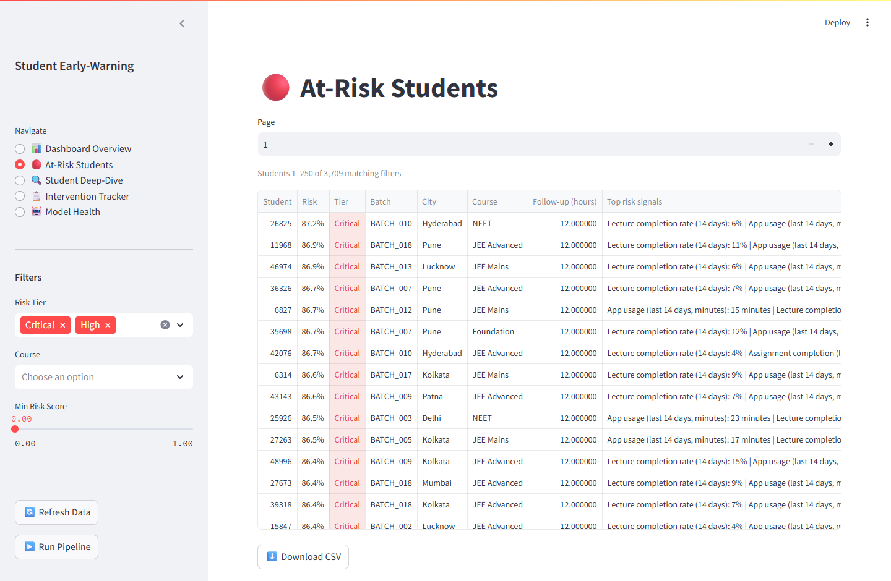
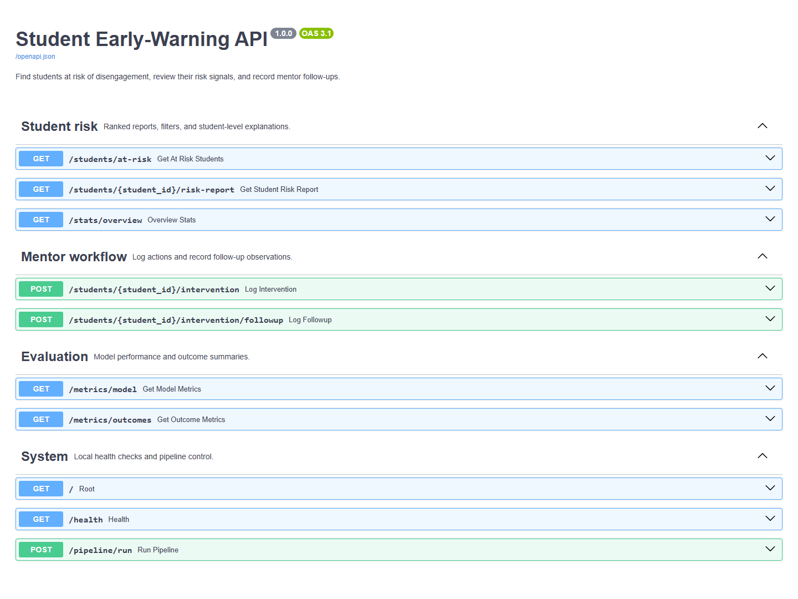
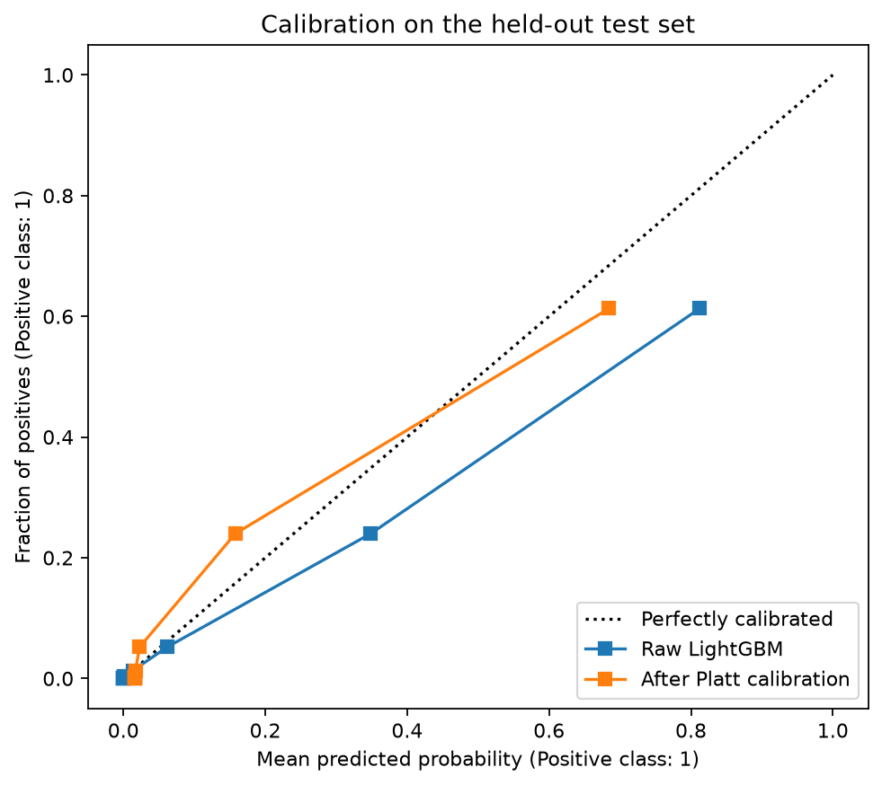
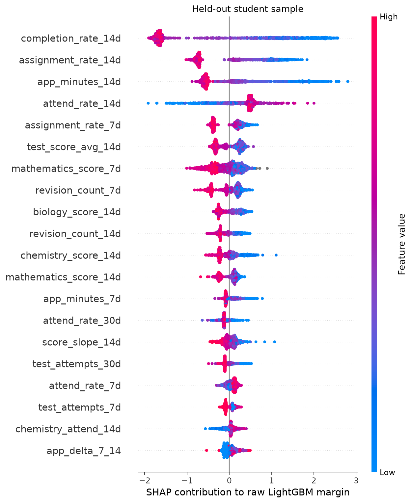

# Student Early-Warning System

## Why I built this

As a Student Mentor at Physics Wallah, I managed 2,000+ students and watched the same
pattern repeat: learners went quiet weeks before they actually dropped out — falling
attendance, slipping test scores, growing doubt-free silence — and by the time anyone
noticed, re-engagement was nearly impossible. No mentor can manually track thousands of
students. So I built the early-warning system I wished I had: predict disengagement
14 days ahead, explain *why* each student is at risk, and hand mentors a specific,
ranked intervention list.

> **On the data:** real platform logs aren't public, so the pipeline runs on a
> privacy-safe **synthetic dataset** generated by `data/synthetic_generator.py`
> (behavioral dynamics modeled from real engagement patterns). The code is designed
> to run unchanged on real engagement logs.

## What it looks like

**Mentor risk queue** with risk tiers, follow-up deadlines and the signals behind each score.



**Interactive API documentation** for reading risk reports, recording interventions and checking evaluation metrics.



## Example Output

```
Student 1042 | Risk: 78% | Tier: High | Urgency: 48h

⚠️  PRIMARY RISK SIGNALS:
  • Physics attendance dropped 63% over the past 14 days
  • Test accuracy declined from 72% → 51% (past 14 days)
  • No active session for 6 days

📋  RECOMMENDED INTERVENTIONS:
  1. Schedule a 1:1 mentor call within 48 hours
  2. Enrol student in 2-day Physics Recovery Plan
  3. Send personalised re-engagement push notification
```

---

## Quick Start

### 1. Install dependencies
```bash
pip install -r requirements.txt
```

### 2. Run the full pipeline
```bash
python src/pipeline.py
```
*(Generates synthetic data → trains model → scores students → saves risk report)*

### 3. Launch the Streamlit Dashboard
```bash
streamlit run dashboard/app.py
```
Open: http://localhost:8501

### 4. Launch the REST API
```bash
uvicorn api.app:app --reload --host 0.0.0.0 --port 8000
```
Docs: http://localhost:8000/docs

### 5. Run Tests
```bash
pytest tests/ -v --cov=src --cov-report=term-missing
```

---

## Architecture

```
Student Behavioral Data
        │
        ▼
Feature Engineering (40+ rolling-window features)
        │
        ▼
LightGBM Risk Model + Platt Calibration
        │
        ├──► Risk Score + Tier (Low/Medium/High/Critical)
        │
        ▼
SHAP Root-Cause Analysis
        │
        ├──► Top-3 Human-Readable Risk Factors
        │
        ▼
Intervention Engine (Rules + Gemini LLM)
        │
        ├──► Specific Actions + Counselor Narrative
        │
        ▼
Outcome Tracker (7d/14d follow-up re-scoring)
```

---

## Project Structure

```
├── data/
│   ├── synthetic_generator.py    # Generates 50,000 student records (configurable via config.yaml)
│   ├── raw/                      # Generated CSVs
│   └── processed/                # risk_report.csv
│
├── src/
│   ├── ingestion/data_loader.py          # Load & validate data
│   ├── features/feature_engineering.py  # 40+ rolling-window features
│   ├── models/
│   │   ├── risk_model.py                # LightGBM + calibration
│   │   └── model_registry.py            # Save/load artifacts
│   ├── explainability/shap_explainer.py # SHAP root-cause analysis
│   ├── interventions/recommendation_engine.py  # Rules + Gemini LLM
│   ├── tracking/outcome_tracker.py      # Outcome logging & KPIs
│   └── pipeline.py                      # End-to-end orchestrator
│
├── api/app.py                    # FastAPI REST backend
├── dashboard/app.py              # Streamlit counselor UI
├── tests/                        # pytest test suite
├── config.yaml                   # All tunable thresholds
└── requirements.txt
```

---

## Feature Groups (40+ features)

| Group | Features |
|---|---|
| Attendance | `attend_rate_7d/14d/30d`, `attend_delta_7_14`, `completion_rate_14d` |
| Test Performance | `test_score_avg_7d/14d/30d`, `score_slope_14d`, `score_delta_14d` |
| Session Behavior | `days_since_last_session`, `session_freq_7d/14d` |
| Assignment | `assignment_rate_7d/14d` |
| Doubt Activity | `doubt_count_7d/14d`, `doubt_delta_7_14` |
| Revision | `revision_count_7d/14d` |
| App Engagement | `app_minutes_7d/14d`, `app_delta_7_14` |
| Peer Comparison | `attend_vs_batch`, `score_vs_batch`, `progress_vs_batch` |
| Subject-Level | `physics_attend_drop_pct`, `chemistry_score_drop_pct`, etc. |

---

## Success Metrics

| Metric | Measurement |
|---|---|
| AUC-ROC | Evaluated on 20% held-out test set |
| Precision/Recall at 50% threshold | Classification report |
| CV AUC (5-fold) | Cross-validation |
| Recovery rate @7d/@14d | Outcome tracker |
| Students recovered per 1,000 flagged | Dashboard KPI |
| Avg score improvement | Pre/post intervention comparison |

## Results

| Metric | Value |
|---|---|
| Cross-validated AUC (5-fold, leakage-free) | 0.959507 ± 0.002217 |
| Held-out test AUC | 0.957826 |
| Precision @ 0.50 threshold | 0.629067 |
| Recall @ 0.50 threshold | 0.629067 |
| Brier score (before → after calibration) | 0.050801 → 0.046750 |

The evaluation used 50,000 synthetic students, with 10,000 reserved for the
held-out test. Cross-validation used only the development split, and both
calibration curves use predictions from the same underlying LightGBM model.
The synthetic label measures a drop in lecture attendance during the forecast
window. Intervention outcomes are simulated and still require validation on
real student data.




---

## Key design decisions

- **Strict as-of-date features.** The original pipeline included the first day of
  the label window in its features. The pipeline now builds features from events
  strictly before the forecast window and keeps the held-out students outside
  cross-validation and calibration.
- **Platt calibration.** Fit a sigmoid on out-of-fold predictions so that risk
  tiers can use calibrated probabilities. The held-out Brier score measures
  the effect on probability accuracy.
- **SHAP-grounded interventions.** Each student report shows the three model
  features with the strongest contributions toward higher risk. Mentors can
  review the underlying signals before acting.
- **Rules + LLM hybrid for interventions.** Rules select the recommended
  actions. Gemini can draft an optional counselor brief from the same signals
  and actions. The student report keeps the rule-generated action list.

## Configuration

Use a Python 3.12 virtual environment and activate it before following Quick Start
so that `python`, `pip`, and the application commands share the same dependencies.

Edit `config.yaml` to tune the project.

- **Synthetic dataset size and forecast cutoff**
- **Gemini model and narrative toggle**
- **Risk tier thresholds** (Low/Medium/High/Critical)
- **Intervention rules** (drop thresholds, inactivity thresholds)
- **Model hyperparameters** (n_estimators, learning_rate, etc.)
- **Outcome tracking** (recovery threshold, follow-up days)

### Optional Gemini counselor briefs

Create an API key in [Google AI Studio](https://aistudio.google.com/apikey).
In the project root, add the following line to `.env` using your own key.
Use `.env.example` as a template for a new file.

```dotenv
GEMINI_API_KEY=replace_with_your_key
```

The Git-ignored `.env` is read automatically. Open **Student Deep-Dive**, select
a student with recommended actions, and choose **Draft with Gemini** in
**Counselor brief**. The default model is `gemini-3.5-flash-lite`. The request
contains the risk score, tier, model signals and rule-selected actions.
Training and bulk reports use rule-based briefs and can run offline.

### Mentor workflow

1. Filter **At-Risk Students** by risk tier or course, then look up a flagged
   student in **Student Deep-Dive**.
2. Review the risk signals and recommended actions. Use **Log an intervention**
   to record what you did.
3. Record a follow-up through `POST /students/{student_id}/intervention/followup`
   in the API docs. Use **Intervention Tracker** to switch between the mentor
   log and simulated demo outcomes.

The demo outcomes ship with the repository. Mentor entries are saved locally in
`data/mentor_outcomes.csv`, which Git ignores. Pipeline reruns refresh the
simulation without overwriting mentor entries. Use the dashboard and API as a
local demo with synthetic data.
